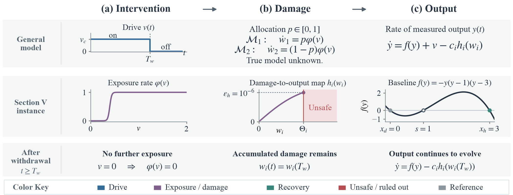

# Restorative Control and the Limits of Safe Model Discrimination

**Paper:** [arXiv:2610.09442](https://arxiv.org/abs/2610.09442)

This repository reproduces both figures and every numerical value reported in
the paper.

The paper studies interventions that must move a system into a desired basin
of attraction and then stop, while the intervention causes irreversible damage.
Two candidate models share the same measured output but route the damage
differently. For the paper's bistable example, the code computes a lower bound
on the exposure any basin crossing requires. It also checks a drive schedule
that restores both candidates when tolerance is sufficient, and evaluates the
risk bound for noisy sampled observations.



## Reproducing the results

Python 3.10 or later.

```bash
pip install -r requirements.txt
python reproduce.py
```

This takes about ten seconds. It recomputes every certificate, checks each
inequality used in the paper, and rewrites `outputs/`.

## Outputs

| File | Contents |
|---|---|
| `outputs/figures/figure1_overview.pdf` | Figure 1 |
| `outputs/figures/figure2_exposure.pdf` | Figure 2 |
| `outputs/results/paper_values.md` | Table I and every value quoted in Section V and the Figure 2 caption, at full precision and as printed |
| `outputs/results/certificates.json` | Full-precision values and verification details |

## Code

| File | Contents |
|---|---|
| `restorative_control/model.py` | The Section V instance: baseline field, damage-rate map, tolerances and constants |
| `restorative_control/certificates.py` | Lower exposure bound, comparison drive and ODE checks, noisy-observation risk bound |
| `restorative_control/figure1.py`, `figure2.py` | The two figures |
| `reproduce.py` | Runs everything and writes `outputs/` |

`J_int` is computed by adaptive quadrature and checked against Riemann bounds
and an independent grid search. The comparison drive is checked with
conservative travel-time bounds and two ODE solvers (DOP853 and Radau).

The figures use Times New Roman when it is installed. Otherwise labels fall
back to STIX, which changes text widths slightly but not the plotted data. To
use a font directory directly, set `TIMES_FONT_DIR`.

Tested with Python 3.14, NumPy 2.5, SciPy 1.18 and Matplotlib 3.11.

## Citation

You can cite the paper with:

```bibtex
@misc{myers2026restorative,
  title         = {Restorative Control and the Limits of Safe Model Discrimination},
  author        = {Myers, Jr., Micheal},
  year          = {2026},
  eprint        = {2610.09442},
  archivePrefix = {arXiv},
  primaryClass  = {eess.SY},
  url           = {https://arxiv.org/abs/2610.09442}
}
```

## License

MIT. See `LICENSE`.
